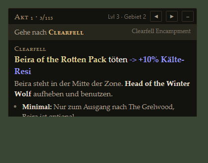
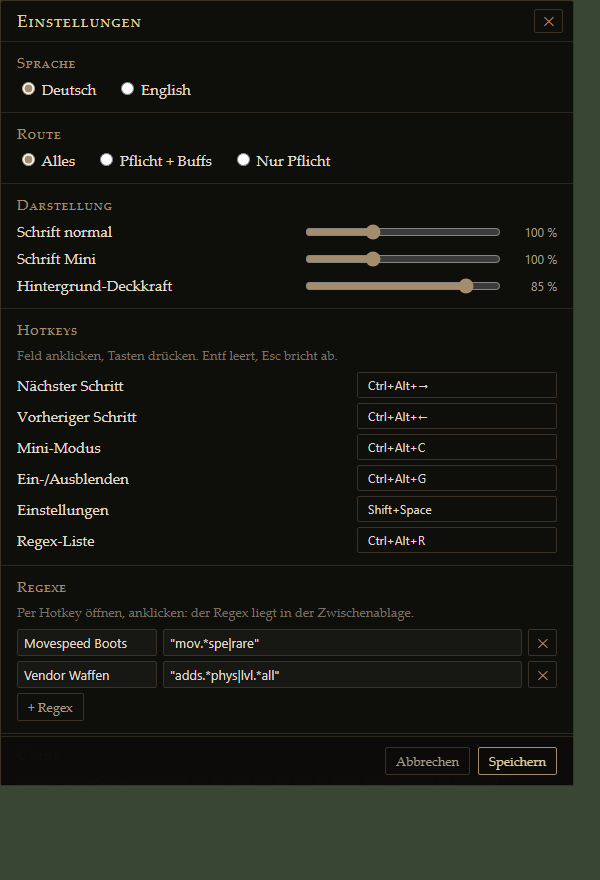

# PoE2 Overlay

An in-game campaign guide for Path of Exile 2. It sits on top of the game, knows which zone you are in and tells you what to do there and where to go next.

No ads, no Overwolf, no account, no telemetry. One small Windows app, open source.

<p>
  
  
</p>
<p></p>

*(German UI shown, English is one click away.)*

## Features

- **Follows your zone.** Reads the game's `Client.txt` and jumps to the right step when you enter a zone. A portal to town does not skip ahead, walking back through it undoes the jump.
- **Knows when a step is done.** Permanent rewards (resistances, spirit, life, mana, books of specialisation) show up in the log, and the guide moves on by itself.
- **Go to.** In town, in your hideout or in the wrong zone it says where to go for the current step, and after each task where to go next.
- **Mini mode.** One line: the task, or where to go and the task.
- **Route modes** like on the website: everything, required + buffs, or required only.
- **Level check.** Character level against area level, red when you are outside the XP penalty window.
- **Regex list.** Save vendor and stash regexes (for example from a build guide). One hotkey opens the list, a click puts the regex on the clipboard and the game keeps focus.
- **Settings in game.** Hotkeys, language (German/English), route mode, regexes, text size for the panel and the mini line, background opacity.
- **Small.** Rust + the WebView2 that ships with Windows. The installer is under 4 MB, idle CPU is zero.

## Install

1. Download `PoE2 Overlay_<version>_x64-setup.exe` (or the `.msi`) from [Releases](../../releases).
2. Run it. The installer is not code-signed, so Windows SmartScreen may warn: *More info* -> *Run anyway*.
3. Start PoE2 in **Windowed** or **Windowed Fullscreen**. Exclusive fullscreen hides every overlay.
4. Start PoE2 Overlay. It lives in the tray (yellow diamond) and shows up when the game is in front.

Windows 10 and 11 already have WebView2. If yours does not, the installer fetches it.

## Usage

| Keys | Action |
|---|---|
| `Shift+Space` | Settings |
| `Ctrl+Alt+R` | Regex list: click one to copy it |
| `Ctrl+Alt+Right` / `Ctrl+Alt+Left` | Next / previous step |
| `Ctrl+Alt+C` | Toggle mini mode |
| `Ctrl+Alt+G` | Hide / show the overlay |

All hotkeys can be changed in the settings. If another app already owns one (Exiled Exchange 2 uses `Shift+Space` by default), the panel says so in red and the overlay keeps trying every few seconds.

- **Move the panel** by dragging its header, or the line in mini mode. In the lower half of the screen it opens upwards.
- **Mini mode:** a click on the line opens the full panel.
- **Tray icon:** settings, reset the guide to the start, quit.

### Copying regexes from websites

Some "copy" buttons (Mobalytics, for one) put the text on the clipboard only as HTML. Plain text fields, including the search box in PoE2, then paste nothing. The regex field in the settings handles this: paste with `Ctrl+V` and the overlay takes the text out of the HTML. Selecting the text and pressing `Ctrl+C` always works too.

## How it works

| Part | How |
|---|---|
| Window | Tauri 2: a Rust app with the system WebView2. The overlay window is exactly the size of the panel, always on top, and never takes focus, so clicks next to it go to the game. |
| Game window | Every 100 ms it looks for the window titled `Path of Exile 2`, keeps the panel inside its client area and hides it when the game is not in front. |
| Zone and level | Tails `logs\Client.txt` next to the running game's exe (any install path, Steam or standalone). It reads `[SCENE] Set Source [<zone>]`, `Generating level N area "<id>"`, `is now level N` and reward lines such as `has received +10% to [Resistances|Cold Resistance]`. |
| Route | Fetched on every start from [poe2speedrun.malura.de/overlay/guide.json](https://poe2speedrun.malura.de/overlay/guide.json), with the last copy kept for offline starts and one built in. |
| Settings | `%APPDATA%\de.malura.poe2overlay\state.json` |

The overlay only reads the log file the game writes for everyone. It does not read game memory, inject anything or send input to the game. As with every third-party tool, using it is your own call.

## Route data

The steps come from the speedrun guide at [poe2speedrun.malura.de](https://poe2speedrun.malura.de/). A fix there reaches every overlay on its next start; no new release needed. To get it right away: settings -> *Reload now*.

## Build from source

Needs Rust (stable) on Windows.

```
cargo run              # debug build
cargo test             # unit tests
npx @tauri-apps/cli@2.12.1 build   # installers in target/release/bundle/
```

`ui/` is plain HTML, CSS and JavaScript without a build step. The built-in fallback route is `ui/guide.json`; refresh it with
`curl -o ui/guide.json https://poe2speedrun.malura.de/overlay/guide.json`.

### Releases

GitHub Actions runs the tests and builds both installers on every push (download them from the run's artifacts). A tag `vX.Y.Z` also publishes a release with both files; the tag has to match `version` in `tauri.conf.json`.

## Thanks

The approach follows existing open-source tools: [Exiled Exchange 2](https://github.com/Kvan7/Exiled-Exchange-2) for attaching to the game window, [ExileXP](https://github.com/andreins/ExileXP) and [Exile UI](https://github.com/Lailloken/Exile-UI) for reading zones from `Client.txt`.

## License

[MIT](LICENSE)
